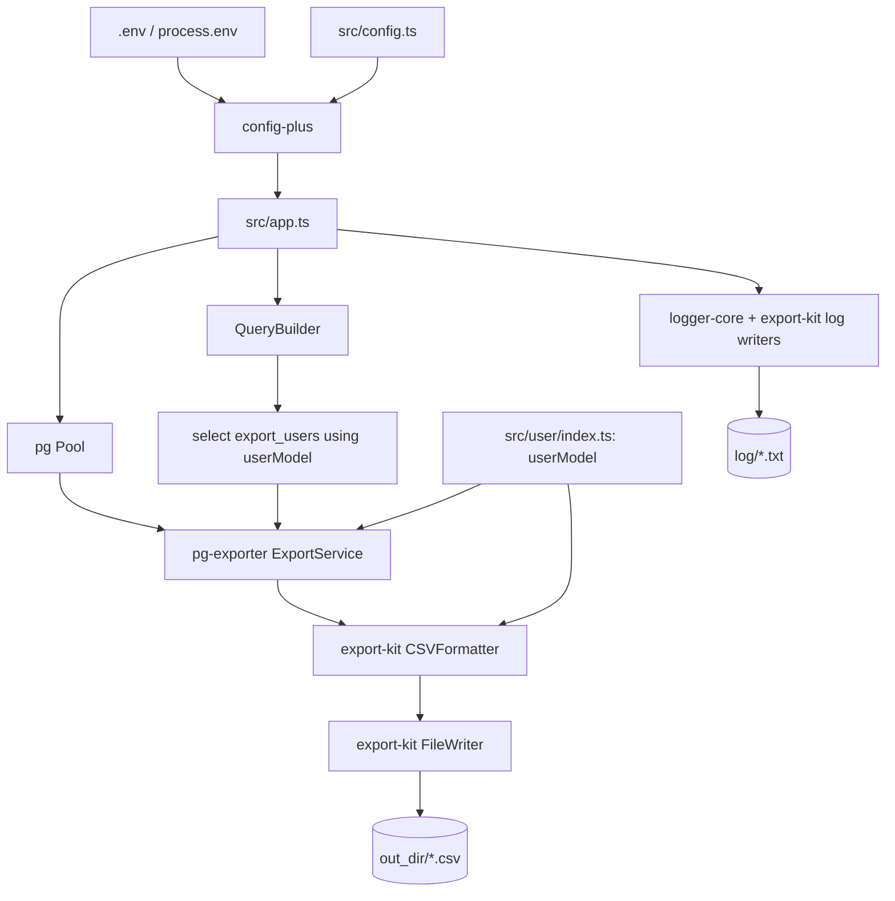

# Architecture

## Architectural shape

The project is a batch job assembled from small libraries. `src/app.ts` owns orchestration; the libraries own the reusable infrastructure tasks.

## Component responsibilities

### `src/app.ts`

- Loads environment variables and merges configuration.
- Creates timestamped error and information log writers.
- Creates the `logger-core` file logger.
- Creates a PostgreSQL `Pool`.
- Creates the query builder, CSV formatter, output stream and file writer.
- Writes the CSV header, invokes `ExportService.export()`, logs the exported count, and closes resources.

It should remain a composition layer. New domain-specific SQL should normally live in a query builder, while row definitions and metadata should live in a domain module.

### `src/config.ts`

Defines the default service name, logger options, file output settings, PostgreSQL pool configuration, and log file locations. The `environments` object currently contains `sit` and `prd` overrides.

### `src/user/index.ts`

Defines two related artifacts:

- `User`: the compile-time TypeScript shape for one exported row.
- `userModel`: a `onecore` `Attributes` object describing keys, lengths, types and database column aliases for formatting/mapping.

The same `userModel` is imported by `app.ts` and reused for SQL selection, CSV formatting and the exporter.

### `pg-exporter`

Owns the PostgreSQL export flow. The application supplies the pool, query builder, model metadata, formatter, writer, progress callback and progress interval. Its design is streaming-oriented; do not replace it with an all-rows-in-memory query without a requirement-driven reason.

### `export-kit`

Owns output formatting and writing. This application uses `CSVFormatter`, `FileWriter`, `createWriteStream`, `createLogWriter`, `getPrefix`, `timeToString` and `toString`.

### `logger-core`

Creates the application logger using the configured logger options and the two file-writer callbacks.

### `config-plus`

Merges defaults, the selected environment profile and environment variables. Keep environment-specific values in `src/config.ts` and secrets in environment variables, not in committed source.

## Dependency direction

Keep the dependency direction simple:

- The application imports and composes infrastructure libraries.
- The domain module defines the exported data contract and metadata.
- The query builder depends on the domain metadata to build its selection.
- The formatter and exporter consume the same metadata.

Avoid making the domain model depend on the application entry point. Avoid placing output-specific formatting logic inside SQL construction.

## Why metadata is shared

The `userModel` prevents the database selection and CSV formatter from each maintaining a separate field list. When adding or renaming a field, update the model, TypeScript interface and CSV header as one change. Confirm the exact behavior of metadata fields against the locked library versions when introducing a new metadata option.
