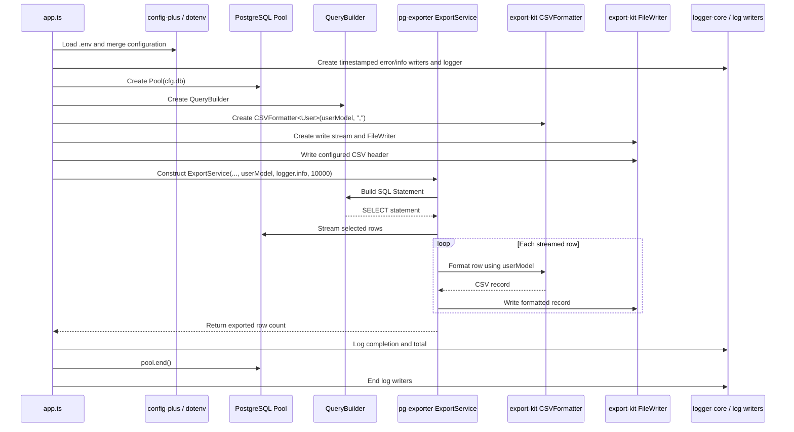

# Export Pipeline

## End-to-end sequence



## Current implementation in `src/app.ts`

1. Capture `now = new Date()` once; use that timestamp to build the CSV and log filenames.
2. Create error and info log writers under their configured directories.
3. Create the logger with `createFileLogger(cfg.log, errorWriter.write, logWriter.write)`.
4. Create a PostgreSQL connection pool using `new Pool(cfg.db)`.
5. Construct `QueryBuilder`. Its constructor binds `build` to the instance.
6. Construct `CSVFormatter<User>(userSchema, ",")`.
7. Create the output stream and wrap it in `FileWriter`.
8. Enter the `try` block, log the start message, and write `cfg.file.header` before exporting records.
9. Construct `ExportService<User>` with these arguments:

   ```ts
   new ExportService<User>(
     pool,
     filename,
     queryBuilder,
     formatter,
     writer,
     userSchema,
     logger.info,
     10000,
   )
   ```

   The final `10000` is the configured progress-report interval in the `pg-exporter` design. Confirm the exact constructor contract against the locked `pg-exporter` version before changing it.

10. Await `exporter.export()`, then log the returned total.
11. On error, log a formatted error message.
12. In `finally`, end the PostgreSQL pool and both log writers.

## Query construction

The current builder is intentionally small:

```ts
export class QueryBuilder {
  constructor() {
    this.build = this.build.bind(this)
  }

  build(cxt?: any): Promise<Statement> {
    const stmt: Statement = { query: select("export_users", userSchema) }
    return Promise.resolve(stmt)
  }
}
```

`select("export_users", userSchema)` makes the shared metadata the selection definition. The current builder ignores its optional `cxt` and returns no query parameters.

For future filtering, keep statement construction in the builder and use the installed `Statement` parameter mechanism. Pass user/runtime values as SQL parameters; never interpolate them into SQL strings.

## Streaming and memory

`pg-exporter` is designed to stream PostgreSQL rows through the formatter and writer rather than loading the full result set into one array. Preserve this design for large exports. Backpressure, stream errors and writer lifecycle should be handled according to the exact APIs of the locked versions when extending the pipeline.

## Output and logging

- CSV output path: `cfg.file.path`.
- CSV prefix: `cfg.file.prefix`.
- CSV header: `cfg.file.header`.
- Error logs: `cfg.error.directory`, `cfg.error.prefix`, `cfg.error.suffix`.
- Info logs: `cfg.info.directory`, `cfg.info.prefix`, `cfg.info.suffix`.
- Logger behavior: `cfg.log`.

The output filename and log filenames all use the `now` value captured at the start of the run, which keeps the files associated with the same execution timestamp.

## Failure and cleanup behavior

The current `catch` logs an error but does not rethrow it or set `process.exitCode`. A scheduler may therefore see a normal process exit even though the export failed. Preserve current behavior only if that is intentional. For production batch execution, explicitly decide how failure should be surfaced.

The `finally` block closes the database pool before ending the log writers. If `pool.end()` rejects, subsequent writer cleanup statements may not execute. When changing lifecycle handling, make cleanup resilient so every acquired resource is closed even when another cleanup step fails. Also inspect the exact writer/stream API for an appropriate failure cleanup path.
